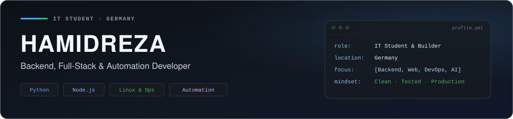

  <picture>
    <source media="(prefers-color-scheme: dark)" srcset="./assets/banner-dark.svg" />
    <source media="(prefers-color-scheme: light)" srcset="./assets/banner-light.svg" />
    
  </picture>

 

### About Me

I am an **IT Student based in Germany** specializing in **backend engineering**, **asynchronous Python services**, **full-stack web applications**, and **Linux/DevOps automation**. I focus on shipping production-hardened systems with strict security boundaries, crash-safe persistence, automated testing, and clean, zero-bloat architecture.

- **Systems & Backend:** Async APIs and background workers (`FastAPI`, `aiohttp`, `Node.js/Express`), MongoDB (`Motor`/`Mongoose`), SQLite with auto-migrations, and fault-tolerant ingestion pipelines.
- **Automation & Telegram Ecosystems:** Full Telegram Mini Apps (HMAC-SHA256 `initData` auth), high-throughput `Telethon` & `python-telegram-bot` services, multi-tier web monitoring (`curl_cffi`, `Patchright`, `Playwright`), and scheduled publishers.
- **Production Operations & Security:** Linux `systemd` services, `Nginx` & `Caddy` HTTPS reverse proxies, encrypted off-site backups (`age`), SSRF/CSP/RBAC hardening, observability healthchecks, and GitHub Actions CI/CD.
- **AI Engineering & Tooling:** Structured master-prompt and 360-degree software auditing frameworks for agentic coding workflows.

---

### Core Engineering Domains

| Domain | Proven Capabilities |
| :--- | :--- |
| **Async Python & APIs** | `FastAPI`, `Pydantic v2`, `aiohttp`, `asyncio`, `Flask`, `Gunicorn / Uvicorn`, crash-safe workers, global rate/flood-lock control |
| **Full-Stack Web & Reporting** | `Node.js`, `Express`, `Vanilla JS (ES2023)`, `Jinja2`, `Chart.js`, `ExcelJS`, `PDFKit`, `Pillow` card rendering, zero-build strict-CSP UIs |
| **Data & Persistence** | `MongoDB` (`Motor`, `Mongoose`, TTL & compound indexes), `SQLite`, atomic file-state persistence, content-addressed media retention |
| **Telegram & Scraping** | Telegram Mini Apps (SPA + HMAC auth), `python-telegram-bot`, `Telethon`, `Playwright / Patchright`, `curl_cffi`, `lxml`, RSS/Atom & diffing |
| **Linux, Ops & Quality** | `Bash / Shell`, `systemd`, `Nginx`, `Caddy`, `age` encrypted backups, `GitHub Actions`, `pytest`, `Playwright + axe-core` (A11y), `Ruff`, `ESLint`, `pip-audit` |

---

### Tech Stack

**Languages**

**Backend, Async & Web**

**Databases, Telegram & Browser Automation**

**Infrastructure, DevOps & Testing**

---

### Featured Projects

| Repository | Summary | Key Stack |
| :--- | :--- | :--- |
| [**webmonitor**](https://github.com/whamidrezaw/webmonitor) | Multi-tier real-time website, API, RSS & Telegram change-monitoring platform with word-level diffing, Telegram Bot + Mini App SPA, interactive challenge server, SSRF guard, and 281+ CI tests. | `Python` `aiohttp` `Patchright` `curl_cffi` `SQLite` `Caddy` `systemd` |
| [**time_manager_pro**](https://github.com/whamidrezaw/time_manager_pro) | Dual-calendar (Gregorian/Jalali) Telegram Mini App & Bot featuring crash-safe reminder workers, shareable Pillow event cards, HMAC auth, Playwright + `axe-core` accessibility tests, and ADRs. | `FastAPI` `Motor` `MongoDB` `Pydantic` `Playwright` `pytest` `Ruff` |
| [**Lagerverwaltung**](https://github.com/whamidrezaw/Lagerverwaltung) | Production supermarket inventory web app with RBAC, automated midnight daily close, Excel/PDF reporting, strict-CSP zero-build frontend, Nginx HTTPS, and `age`-encrypted off-site backups. | `Node.js` `Express` `MongoDB` `Shell` `Nginx` `ESLint` `CI` |
| [**NewsRadar**](https://github.com/whamidrezaw/NewsRadar) | High-throughput async Telegram channel monitoring and MongoDB ingestion pipeline with parallel worker pools, coordinated global `FloodWait` locking, and real-time observability alerts. | `Python` `asyncio` `Telethon` `Motor` `MongoDB` `Flask` |
| [**toman-live-publisher**](https://github.com/whamidrezaw/toman-live-publisher) | Automated timezone-aware Telegram daily content publisher with atomic crash-safe state persistence and PaaS health-check server. | `Python` `asyncio` `python-telegram-bot` `Flask` |
| [**just-prompt**](https://github.com/whamidrezaw/just-prompt) | Structured master prompt & 360-degree software engineering audit frameworks designed for AI coding assistants and agentic IDEs. | `Prompt Engineering` `AI Workflows` `Architecture` |

---

### GitHub Metrics

  <picture>
    <source media="(prefers-color-scheme: dark)" srcset="https://github-readme-stats.vercel.app/api?username=whamidrezaw&show_icons=true&include_all_commits=true&count_private=true&hide_border=true&bg_color=0d1117&title_color=58a6ff&text_color=c9d1d9&icon_color=3fb950" />
    <source media="(prefers-color-scheme: light)" srcset="https://github-readme-stats.vercel.app/api?username=whamidrezaw&show_icons=true&include_all_commits=true&count_private=true&hide_border=true&bg_color=f6f8fa&title_color=0969da&text_color=1f2328&icon_color=1a7f37" />
    
  </picture>
  <picture>
    <source media="(prefers-color-scheme: dark)" srcset="https://github-readme-stats.vercel.app/api/top-langs/?username=whamidrezaw&layout=compact&langs_count=6&hide_border=true&bg_color=0d1117&title_color=58a6ff&text_color=c9d1d9" />
    <source media="(prefers-color-scheme: light)" srcset="https://github-readme-stats.vercel.app/api/top-langs/?username=whamidrezaw&layout=compact&langs_count=6&hide_border=true&bg_color=f6f8fa&title_color=0969da&text_color=1f2328" />
    
  </picture>

  <picture>
    <source media="(prefers-color-scheme: dark)" srcset="https://streak-stats.demolab.com?user=whamidrezaw&hide_border=true&background=0d1117&ring=58a6ff&fire=3fb950&currStreakLabel=58a6ff&sideLabels=c9d1d9&currStreakNum=f0f6fc&sideNums=f0f6fc&dates=8b949e" />
    <source media="(prefers-color-scheme: light)" srcset="https://streak-stats.demolab.com?user=whamidrezaw&hide_border=true&background=f6f8fa&ring=0969da&fire=1a7f37&currStreakLabel=0969da&sideLabels=1f2328&currStreakNum=1f2328&sideNums=1f2328&dates=57606a" />
    
  </picture>

---

### Contribution Activity

  <picture>
    <source media="(prefers-color-scheme: dark)" srcset="https://raw.githubusercontent.com/whamidrezaw/whamidrezaw/output/github-contribution-grid-snake-dark.svg" />
    <source media="(prefers-color-scheme: light)" srcset="https://raw.githubusercontent.com/whamidrezaw/whamidrezaw/output/github-contribution-grid-snake.svg" />
    
  </picture>

